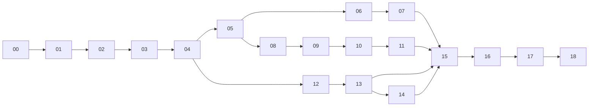

# SchoolHub — PRD set for forge

These 19 PRDs describe **SchoolHub**, a full school management and learning platform for admins, teachers, students and parents. They are written to be built one at a time with `forge run`. Each run sees only its own PRD, so every PRD:

- repeats the same **Platform Context** block (stack, folder layout, API conventions, roles, assumptions), and
- assumes all lower-numbered PRDs are already built in the workspace.

**Stack:** Next.js 14 + TypeScript, PostgreSQL + Prisma, Auth.js, **Material UI v9 + MUI X v9 only** (Data Grid, Date Pickers, Charts, Scheduler), Zod, Vitest + Playwright. One repo, one forge `--tech-stack react`.

**UI rule:** every screen uses MUI components only, and every component is looked up through the **MUI MCP server** (`mui-mcp`: `useMuiDocs` → `fetchDocs`) before it is used. Other UI libraries are banned, and an ESLint `no-restricted-imports` rule added in PRD-00 enforces the ban. Requirements before running forge:
- `mui-mcp` must be configured for the `claude` CLI (it is, at user scope: `claude mcp get mui-mcp`).
- forge's `claude-task-adapter.js` now allows `mcp__mui-mcp__useMuiDocs` and `mcp__mui-mcp__fetchDocs` by default. Without that, headless `claude -p` runs deny MCP calls.

## Build order

| # | Ticket | PRD | What it adds | Milestone |
|---|---|---|---|---|
| 00 | SCH-000 | [Foundation](00-foundation.md) | Scaffold, DB, app shell, design system, API helpers | 1 Core |
| 01 | SCH-001 | [Auth & RBAC](01-auth-rbac.md) | Login, invites, reset, lockout, roles, audit log | 1 Core |
| 02 | SCH-002 | [Academic structure](02-academic-structure.md) | School settings, years, terms, grades, subjects, rooms | 1 Core |
| 03 | SCH-003 | [User management](03-user-management.md) | Users, profiles, parent links, CSV import, audit viewer | 1 Core |
| 04 | SCH-004 | [Notifications](04-notifications.md) | In-app bell, email outbox, templates, preferences | 1 Core |
| 05 | SCH-005 | [Classes & enrollment](05-classes-enrollment.md) | Sections, courses, enrollment, rosters | 1 Core |
| 06 | SCH-006 | [Timetable](06-timetable.md) | Bell schedule, clash-free drag-and-drop timetable | 2 Teaching |
| 07 | SCH-007 | [Attendance](07-attendance.md) | Mobile register, absence alerts, reports | 2 Teaching |
| 08 | SCH-008 | [Course content](08-course-content.md) | File storage, modules, lessons, progress | 2 Teaching |
| 09 | SCH-009 | [Assignments](09-assignments.md) | Submissions, late policy, rubrics, grading | 2 Teaching |
| 10 | SCH-010 | [Quizzes](10-quizzes.md) | 5 question types, timed player, auto-grading, analytics | 2 Teaching |
| 11 | SCH-011 | [Gradebook](11-gradebook.md) | Weighted gradebook, grading scales, report cards | 2 Teaching |
| 12 | SCH-012 | [Announcements](12-announcements.md) | Targeted announcements, acknowledgements, public news | 3 Communication |
| 13 | SCH-013 | [Messaging](13-messaging.md) | Safe direct messaging, contact rules, safeguarding | 3 Communication |
| 14 | SCH-014 | [Calendar](14-calendar.md) | Events, holidays, RSVP, iCal feed | 3 Communication |
| 15 | SCH-015 | [Parent portal](15-parent-portal.md) | Child switcher, absence notes, conferences, consent forms | 3 Communication |
| 16 | SCH-016 | [Dashboards](16-dashboards.md) | Role dashboards, at-risk students, reports | 4 Operations |
| 17 | SCH-017 | [Fees](17-fees.md) | Fee plans, invoices, payment records, receipts | 4 Operations |
| 18 | SCH-018 | [Public site & admissions](18-public-site-admissions.md) | CMS pages, admissions pipeline, contact form | 4 Operations |



The order is strict: run them in number order, because later PRDs extend code from earlier ones (for example, PRD-14 changes the attendance and timetable code to handle holidays).

## Running

Run one at a time and review each before moving on:

```bash
mkdir -p ~/schoolhub && cd ~/schoolhub && git init
forge run --prd /Users/ikramaansari/Documents/forge/schoolhub-prds/00-foundation.md --ticket SCH-000 --tech-stack react --greenfield
# review, run the app, commit, then:
forge run --prd /Users/ikramaansari/Documents/forge/schoolhub-prds/01-auth-rbac.md --ticket SCH-001 --tech-stack react --brownfield
```

Or let `run.sh` loop through them, committing after each PRD and stopping on the first failure:

```bash
./run.sh ~/schoolhub              # all 19, with forge's approval gates
./run.sh ~/schoolhub 5 8          # PRDs 05–08 only
./run.sh ~/schoolhub 0 18 --autonomous
```

Tips:
- Always pass `--tech-stack react`. Words like "node" in the PRD text can otherwise auto-detect the wrong stack.
- After each run: `docker compose up -d && npm run db:migrate && npm run db:seed && npm run dev`, then check the PRD's acceptance criteria by hand before running the next one. A bug left in PRD-03 shows up again in every PRD after it.
- Use `forge run --plan-only` first on the bigger PRDs (09, 10, 11, 17, 18) to check the plan before code is written.
- Seed logins (from PRD-01): `admin@`, `teacher@`, `student@`, `parent@schoolhub.test`. The password for all of them is `SchoolHub123!`.

## Editing the PRDs

The Platform Context block is copied into every file on purpose, so each forge run sees it. If you change the stack or a convention, update the block in all 19 files. They are identical, so one find-and-replace works.
